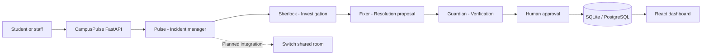

# CampusPulse AI — Autonomous Campus Operations Team

> Every campus issue deserves an intelligent response.

CampusPulse AI is a multi-agent campus incident workflow for reporting, investigating, proposing and reviewing operational issues. The application includes a React operations console, a FastAPI service, persistent incident/approval/activity records, a Discord intake bot, and a server-side Switch agent-protocol client.

**Current implementation status:** the dashboard and API support a clearly labelled deterministic demo workflow. Switch protocol primitives (health check, one-time registration helper, message posting and WebSocket event client) are implemented, but a live Switch deployment, agent credentials, Discord bot credentials and live model provider have not been supplied or verified in this environment. Do not describe the current run as a live Switch integration until those are configured and tested.

## What it does

- Pulse: classifies reports, sets priority and coordinates the workflow.
- Sherlock: summarizes available evidence and distinguishes hypotheses from verified findings.
- Fixer: proposes safe troubleshooting steps.
- Guardian: reviews risk and creates a human approval request.
- Human approval: authorized teammates approve, reject or request changes.
- Resolution evidence: a human must provide evidence before an incident is marked resolved.

The included demo walkthrough uses a Wi-Fi outage report in CSE Block, Room 302. Demo-mode content is explicitly simulated; it does not query campus telemetry and does not claim a physical fix occurred.

## Architecture

**Current implementation:** The application currently runs a deterministic demo workflow through the CampusPulse FastAPI backend.

**Planned live architecture:** The diagram below shows the intended integration with Switch shared rooms and four specialized agents. Live Switch communication has not yet been verified.



## Technology

- Frontend: React, TypeScript, Vite, Recharts, Framer Motion-ready design system, Lucide React
- Backend: Python, FastAPI, Pydantic, SQLAlchemy
- Database: SQLite by default; SQLAlchemy URL can be changed to PostgreSQL
- Integrations: Discord Bot API and Switch agent protocol (WebSocket + HTTP)
- Container: Docker

## Run locally (Windows PowerShell)

### 1. Backend

```powershell
cd backend
py -3.11 -m venv .venv
.venv\Scripts\Activate.ps1
pip install -r requirements.txt
Copy-Item .env.example .env
python run.py
```

API docs: http://localhost:8000/docs
Health: http://localhost:8000/api/health

### 2. Frontend

Open a second terminal:

```powershell
cd frontend
npm install
npm run dev
```

Open http://localhost:5173.

## Demo workflow

1. Start the backend and frontend.
2. Open **Incidents** and select **Report incident**.
3. Submit a campus issue, e.g. "Wi-Fi has stopped working in CSE Block, Room 302 before an online examination."
4. The demo workflow records Pulse, Sherlock, Fixer and Guardian activities.
5. Open **Approvals** and review the proposed action.
6. An approval moves the incident to **In Progress**, not Resolved.
7. Only a separate human resolution confirmation with evidence should close the incident. (The API endpoint is `POST /api/incidents/{id}/confirm-resolution`.)

## Switch integration

Switch is not an AI model or chat app; it connects agents and people in shared rooms. Switch currently documents a WebSocket agent protocol. The `switch/campuspulse-room.template.yaml` file defines the four Switch Console agent identities and a shared room. Import it in Switch Console, select a supported provider (Codex is a suitable primary choice) and the configured chat bridge, then onboard the agents. The backend also includes `app/integrations/switch_client.py` with:

- `GET /health` probe against `SWITCH_BASE_URL`.
- One-time `POST /agents` registration using `SWITCH_REGISTRATION_KEY`.
- `POST /agents/{agent_id}/message` using the agent API key.
- WebSocket connection to `/agents/{agent_id}/connection/ws`, ping/pong cursor handling, addressed-message filtering, and reconnect attempts.

Official protocol references:

- https://docs.switchagents.ai/switch-rooms/internals/agent-protocol
- https://docs.switchagents.ai/switch-rooms/internals/agent-connection
- https://github.com/sandbox-quantum/switch

Important setup notes:

1. Install Switch Console and start a Switch server. Switch Console requires Docker and a supported agent provider; Codex is supported by Switch Console.
2. Configure a Switch registration key. Register each long-running custom agent once; store the returned agent id and API key securely. Do not register on every app startup.
3. Add the agent to the target room and configure who may address it. The protocol defaults a new agent to owner-only addressing.
4. Set `SWITCH_BASE_URL`, `SWITCH_AGENT_ID`, `SWITCH_AGENT_API_KEY`, and `SWITCH_ROOM_ID` in `backend/.env`.
5. The sample client is a protocol integration foundation, not proof that the four room agents are connected. Test registration, membership, WebSocket events and message handoff against your actual Switch server before selecting live mode. For the hackathon demo, make Switch the actual shared room used by the four agent identities; do not rely on the standalone simulated API workflow as evidence of Switch usage.

The hackathon brief says Switch supports Discord, but the easiest fallback for a reproducible demo is the bundled Mattermost environment that ships with local Switch. Use Discord only after the Discord collaboration bridge is configured.

## Discord bot

1. Create a bot in the Discord Developer Portal.
2. Enable **Message Content Intent**.
3. Invite it to a test server with message read/send permissions.
4. Set `DISCORD_BOT_TOKEN` and optional `DISCORD_CHANNEL_ID` in `backend/.env`.
5. Start the bot as a separate process (see below). It is intentionally not auto-started by the API process so local API development does not fail when the Discord token is absent.

Start bot:

```powershell
cd backend
python -c "import asyncio; from app.integrations.discord_bot import run_discord_bot; asyncio.run(run_discord_bot())"
```

The Discord intake handler creates an incident and replies with its id. In this starter it uses the transparent demo workflow; it does not claim the Discord event was processed by Switch. Wire the Discord bridge through Switch for the judged live workflow.

## Environment variables

See `backend/.env.example`. Secrets belong only in the backend environment. Never commit `.env` or place credentials in frontend variables.

## Docker

```powershell
Copy-Item backend/.env.example backend/.env
docker compose up --build
```

The compose file starts the API and frontend. For the simplest local setup, SQLite is persisted in `backend/data`.

## Tests

```powershell
cd backend
pip install -r requirements.txt
pytest
```

## Limitations and next steps

- Add authentication and role-based authorization before any real campus deployment.
- Add verified campus telemetry connectors (network controller, device monitoring, facilities ticketing).
- Connect each of the four agent identities to actual Switch rooms and configure agent addressing/permissions.
- Use a model provider for evidence-grounded analysis; keep unverified causes explicitly labelled as hypotheses.
- Add audit-grade user identity, approval policy, retention, rate limiting and security review.
- Add evidence upload and a dedicated UI action for human resolution confirmation.
- Add integration tests against a real Switch server and Discord test guild.

## License

Choose a project license before publishing the repository publicly.

